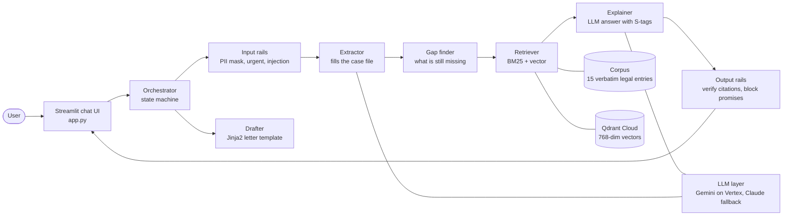
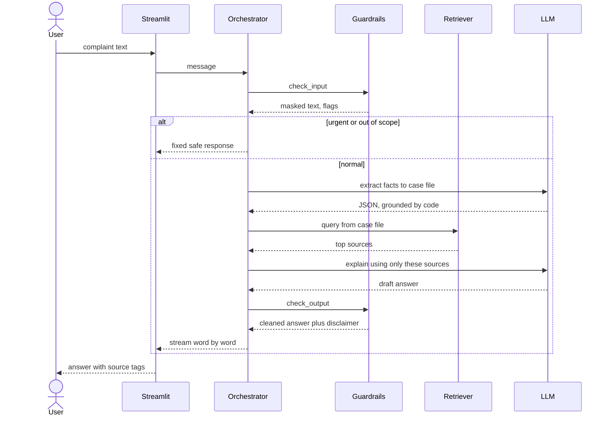
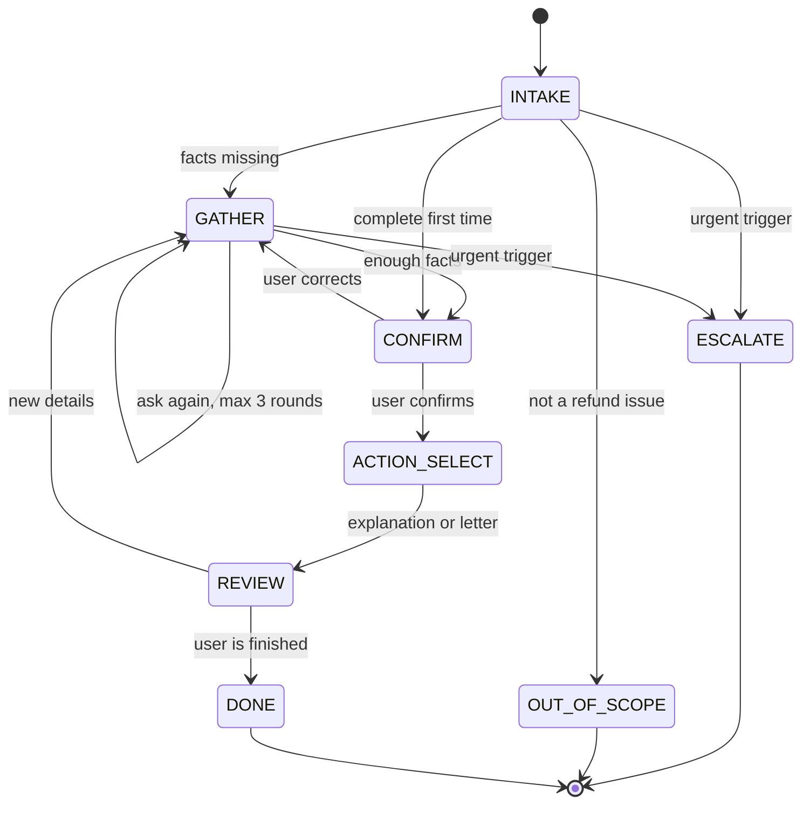
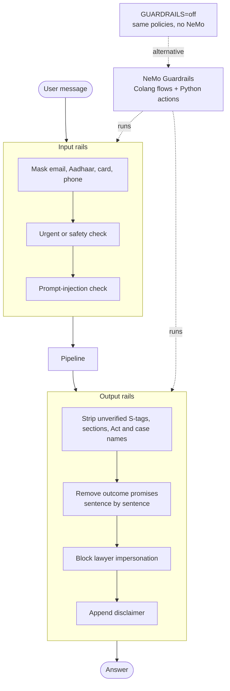
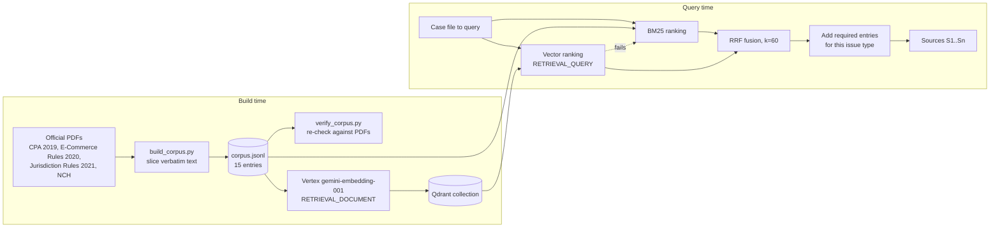
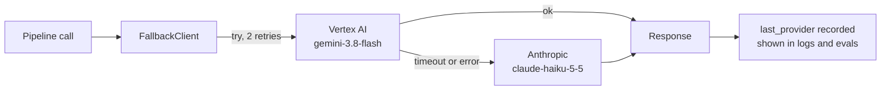
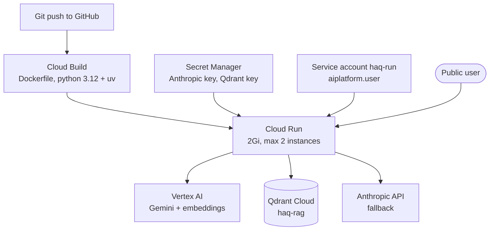
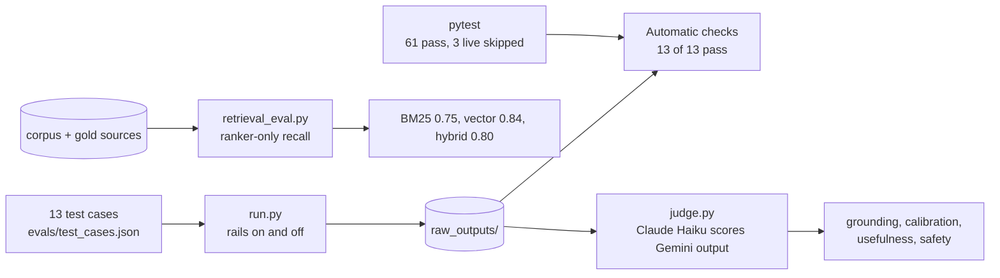

# Haq: architecture

Haq is a legal-information assistant for Indian consumers who want a refund. It collects the facts of a complaint, explains which rights apply using a verified corpus, and drafts a grievance letter. It does not predict outcomes and does not act as a lawyer.

This page is the walkthrough for the video. Each section is one diagram.

## 1. The whole system

Every user message goes through the same pipeline. The LLM never talks to the user directly. Code checks it on the way in and on the way out.

## 2. One turn, step by step

## 3. Conversation states

Urgent cases (threats, police, large fraud) leave the normal path and get a human-help message instead of a legal walkthrough.

## 4. Guardrails

The same policy code runs with or without NeMo, so the evals can compare rails on and off.

## 5. Retrieval and the corpus

Retrieval mode is `bm25`, `vector` or `hybrid`. If Qdrant or the embedding call fails, it drops to BM25 on its own. A small hand-written table adds the entries a case must have (for example Rule 6(3) for damaged goods), because ranking alone missed it in testing.

## 6. LLM layer and fallback

## 7. Where it runs

Cloud Run is the only deployment.

## 8. How it was tested

## 9. What it will not do

- It gives no outcome predictions and no "you will win" language.
- It does not impersonate a lawyer or file anything for the user.
- It cites only entries that exist in the corpus. Anything else is stripped.
- It escalates threats and large-value fraud instead of explaining.
- It has not had a real lawyer review. Usefulness scores about 3 out of 5 because the escalation ladder is fixed.

## Key files

| Area | File |
|---|---|
| UI | `app.py` |
| Flow | `haq/orchestrator.py`, `haq/gaps.py`, `haq/triage.py` |
| Facts | `haq/schema.py`, `haq/extractor.py`, `haq/consistency.py` |
| Retrieval | `haq/corpus.py`, `haq/embeddings.py`, `haq/vectorstore.py` |
| Answer | `haq/explainer.py`, `haq/drafter.py`, `haq/prompts/` |
| Safety | `haq/guard.py`, `haq/guardrails/`, `haq/policy.py`, `haq/verifier.py`, `haq/redact.py` |
| LLMs | `haq/llm/` |
| Corpus | `data/corpus.jsonl`, `scripts/build_corpus.py` |
| Evals | `evals/`, `tests/` |
